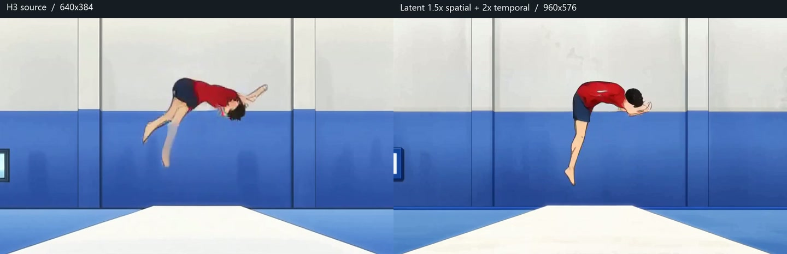

# MiniMax H3 Temporal Latent Upscaler for ComfyUI

Reduce fast-motion smearing, stuck poses, and frame stepping in MiniMax H3 generations. **H3 Latent Auto Repair & Upscale** prepares a second H3 sampling pass directly from the first pass's latent. The default export keeps the source frame count, 24 fps playback, and first-pass audio. An optional spatial pass increases resolution during the same refinement.

## See the difference

[](demos/backflip-spatial-temporal.mp4)

[Watch the backflip](demos/backflip-spatial-temporal.mp4) or browse [all three side-by-side demos](demos/README.md), including a matched pixel De-RoPE comparison and a test of adaptive 1×/2×/3× repair. Every clip plays at the source's 24 fps.

## Quick start

1. Use a recent ComfyUI build with native MiniMax H3 support. The development install used ComfyUI 0.45.0. Install the following custom node packs into its `custom_nodes` folder, following their instructions.
   - MAINodes for the H3 working timeline, sampling schedule, and frame recovery. [ComfyUI-MAINodes](https://github.com/matlowai/ComfyUI-MAINodes)
   - KJNodes for the sample graphs' low-memory model patches. [ComfyUI-KJNodes](https://github.com/kijai/ComfyUI-KJNodes)
   - ComfyUI-GGUF for the sample graphs' compact text encoder. [ComfyUI-GGUF](https://github.com/city96/ComfyUI-GGUF)
2. Open a terminal in `ComfyUI/custom_nodes/` and clone this repository:

   ```sh
   git clone https://github.com/HyRo34/Minimax-H3-Temporal-Latent-Upscaler.git
   ```

   You can also extract the GitHub ZIP into `custom_nodes/`. Make sure the extracted folder directly contains `__init__.py`. The pack uses PyTorch and safetensors from the ComfyUI environment.
3. If you already have a working H3 setup, you can select your installed H3 model, text encoder, and VAEs in the graph. The exact preset files are listed below. Create `models/h3_temporal_models/` if needed and keep the checkpoint's original filename.
4. Restart ComfyUI. Drag a JSON from [workflows](workflows/) onto the canvas. Start with **Fast**, edit the prompt, and queue. For an image-based workflow, select your own image in each active **Load Image** node before queuing. The presets save MP4s under `ComfyUI/output/video/`.

### Preset files

Model directories are relative to your ComfyUI installation. The four presets share one set of weights, about 34 GB of downloads. They use CUDA low-memory helpers. On an 8 GB GPU, model offload needs substantial system RAM and can be slow. Start at the example resolution and length.

| File | Folder | Source |
| --- | --- | --- |
| `minimax_h3_latent_upscaler_3d_conv_v2_temporal_bf16.safetensors` | `models/h3_temporal_models/` | [George0667 temporal v2 BF16, pinned revision](https://huggingface.co/George0667/MiniMax_Temporal_Upscaler/blob/b30591f7215e8198eabb1b05a7984b57bf046176/minimax_h3_latent_upscaler_3d_conv_v2_temporal/minimax_h3_latent_upscaler_3d_conv_v2_temporal_bf16.safetensors) |
| `MiniMax-H3-FL2VA-pruned_rank8_int8_convrot.safetensors` | `models/diffusion_models/` | [DeepBeepMeep H3 FL2VA](https://huggingface.co/DeepBeepMeep/MiniMax-H3/blob/main/MiniMax-H3-FL2VA-pruned_rank8_int8_convrot.safetensors) |
| `qwen3vl-32B-MiniMax-H3-Q2_K.gguf` | `models/text_encoders/` | [ncrzy's H3 GGUF bucket](https://huggingface.co/buckets/ncrzy/MiniMax-H3_GGUFs-bucket) |
| `minimax_h3_video_vae_fp8mix.safetensors` | `models/vae/` | [DeepBeepMeep H3 video VAE](https://huggingface.co/DeepBeepMeep/MiniMax-H3/blob/main/minimax_h3_video_vae_fp8mix.safetensors) |
| `minimax_h3_audio_vae_fp32.safetensors` | `models/vae/` | [Comfy-Org H3 audio VAE](https://huggingface.co/Comfy-Org/MiniMax-H3/blob/main/vae/minimax_h3_audio_vae_fp32.safetensors) |

### Pick a workflow

| Workflow | Use it for |
| --- | --- |
| [Fast temporal repair](workflows/H3_Latent_Temporal_Repair_Fast.json) | Text-to-video at 640 × 384 with adaptive motion repair. Start here. |
| [Joint spatial and temporal](workflows/H3_Latent_Spatial_Temporal_Upscale.json) | Text-to-video with 1.5× latent spatial scaling, from 640 × 384 to 960 × 576. |
| [I2V / FL2V](workflows/H3_Latent_I2V_FL2V_Repair.json) | Upload a first frame. For first-and-last-frame mode, enable **Optional last frame** and **Optional last-frame guide**, then load the end image. |
| [Reference-to-video](workflows/H3_Latent_Ref2V_Repair.json) | Upload the reference and describe it as `<Picture 1>` in the prompt. The graph preserves reference conditioning through refinement. |

For an optional pixel-space finish on a supported NVIDIA setup, install the RTX nodes and put **RTX Video Super Resolution** between **H3 Exact Recover** and **Create Video**. Select **2× Ultra** for 1280 × 768 from the fast preset or 1920 × 1152 from the spatial preset. [NVIDIA RTX Nodes for ComfyUI](https://github.com/Comfy-Org/Nvidia_RTX_Nodes_ComfyUI)

## How it works

```text
First H3 sampler ─┬─► Latent repair ─► H3 refinement ─► Video VAE decode ─► Exact Recover ─┐
                  └─► Decode first-pass audio ──────────────────────────────────────────┴─► MP4
```

1. **Find fast motion.** The node measures changes between H3 video latents in 17-frame blocks, with a final five-frame tail. The adaptive mode uses 1× for calm blocks, 2× for moderate motion and 3× for the strongest motion. This heuristic can miss small fast objects or select a fast camera move.
2. **Give H3 more room to redraw the action.** George0667's v2 checkpoint initializes an expanded latent timeline. The noise mask lets H3 refine the selected blocks while anchoring unchanged sections. Spatial scaling can run in the same initializer. The graph refines with `gradient_estimation` and **Beta 12 / inject 0.42**, which produced five effective steps with the tested Base model.
3. **Return to the original timing.** MAINodes' **H3 Exact Recover** selects a frame at the start of each hold on the refined timeline. A 90-frame anime test used a 141-frame working timeline with block factors `[1, 1, 3, 2, 1, 1]`. Its final video was still **90 frames at 24 fps**. The 2× and 3× settings refer to the working timeline. For higher-fps delivery, use a separate interpolation stage.
4. **Keep the audio timeline.** Pass 2 gets a time-aligned copy of the first-pass audio latent, which is frozen during refinement. The export independently decodes the original first-pass audio and muxes it at the source timing. Visual lip-sync can still vary if H3 redraws mouth shapes.

The pixel-space De-RoPE workflow decodes the first video, stretches it with repeated frames, and encodes that working video before refinement. This node replaces those intermediate video VAE operations with learned latent expansion. Both approaches use a second H3 sampling pass and recover the original playback speed.

### Add it to your own H3 graph

- Connect the first sampler's output and its original positive conditioning to **H3 Latent Auto Repair & Upscale**. Use the node's updated conditioning and its masked latent for the second sampler.
- Decode the second sampler's video. Connect its decoded frames and the repair node's `hold_map` output to **H3 Exact Recover**.
- Connect the first sampler's output and the audio VAE to **H3 Repair · Decode Original Audio**. Give **Create Video** the recovered images and that audio at 24 fps.

## Tuning and limits

- Start with **Auto Adaptive** at `spatial_scale=1.0`. Select `auto_2x` for a cheaper pass when adaptive 3× adds little. Use `full_2x` or `full_3x` when the whole clip needs repair.
- In **manual** mode, enter zero-based ranges with exclusive ends, such as `17-51`. Ranges snap out to the H3 block boundaries and use 2×. Enter `all` for the full clip. An optional Jerk Oracle hold map selects blocks using its holds greater than one.
- For a subtler repair, lower the inject setting toward `0.33`. If you see pose, dialogue, or timing drift, compare against first-pass output before increasing the strength. When all blocks are 1× at the original resolution, the preset can still invoke the second sampler.
- These graphs expect the first sampler's H3 latent. H3 sizes fit a 32-pixel grid and source lengths follow `17k + 5` frames. Use the `_temporal_` checkpoint variant. Joint scaling costs more GPU time, particularly at 2× spatial with long clips.

### Development measurements

On one RTX 4060 Laptop GPU with 8 GB VRAM, a 39-frame basketball clip at 864 × 480 took **86 s** for 2× latent repair versus **123 s** for 2× pixel De-RoPE with the same Base schedule. Preparation took **3.4 s** in latent space versus **40.6 s** in pixel space. These timings exclude the first generation pass.

On a 90-frame anime slash, adaptive repair took **117 s** versus **104 s** for automatic 2× and reduced the measured jump at one block boundary. Delicate fast details such as ribbons can still retain smear or change shape. Check those frames and any dialogue against the source before using a repaired take.

Release checks covered all four graphs in ComfyUI's prompt validator, including both first-frame and first-and-last-frame configurations. A short end-to-end render of the fast graph at 320 × 192 with forced 2× repair exported 39 frames at 24 fps with a 1.625-second audio track.

## Credits

- **MATLOWAI** for MAINodes' Motion Lab, the De-RoPE approach, the working timeline and frame recovery, and the related oracles. [ComfyUI-MAINodes](https://github.com/matlowai/ComfyUI-MAINodes)
- **George0667** for the temporal v2 weights and reference implementation. The weights are distributed by their author under **CC BY-NC 4.0**. [MiniMax Temporal Upscaler](https://huggingface.co/George0667/MiniMax_Temporal_Upscaler)
- **LBH-123-AI** for the original 3D latent-resizer backbone adapted in this pack. [Upstream project](https://github.com/LBH-123-AI/Comfyui_Minimax_h3_latent_Upscaler) · [MIT notice](LICENSES/LBH-MIT.txt)
- **MiniMax**, **Comfy Org**, **Kijai**, **DeepBeepMeep**, **city96**, **ncrzy**, and **NVIDIA** for the underlying H3 model, ComfyUI integration, low-memory nodes, model builds, GGUF tooling and encoder, and optional RTX finishing. H3 assets have their own terms. [MiniMax H3 model and license](https://huggingface.co/MiniMaxAI/MiniMax-H3)
- **TK_999**, **Kijai**, and the **Banodoco** community for the museum-sprint and café-dialogue test scenarios and discussion.

Model weights are downloaded from their publishers. The repository contains node code and example graphs.

The MIT notice covers the adapted LBH backbone. A license for the original node code and workflows has yet to be selected.
