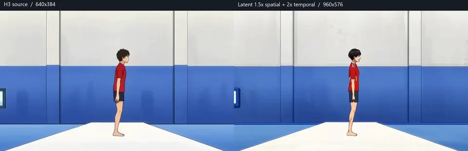

# MiniMax H3 Temporal Latent Upscaler for ComfyUI

Fix fast-motion smear, ghosting, and frame stepping in MiniMax H3 videos—and optionally upscale resolution in the same pass—directly in latent space.

Instead of decoding to pixels and re-encoding like pixel De-RoPE, this pack takes the **latent output of your first H3 sampler**, detects which 17-frame blocks have fast motion, stretches only those moments to 2× or 3× frames during Pass 2 so H3 can redraw them cleanly, and recovers your exact original frame count, 24 fps timing, and untouched Pass-1 audio.

---

## See the Difference

[](demos/README.md#backflip--spatial-and-temporal-repair)

**Watch the trailing leg during the flip.** Left is the raw H3 Pass-1 output (ghosted/smeared limb). Right is Pass-2 adaptive temporal repair + 1.5× spatial latent upscaling, playing at the exact same speed and duration.
👉 [Full comparison gallery (backflip, basketball pixel-vs-latent, anime slash)](demos/README.md)

---

## Updates

### v2.0 — Speed, Quality & Unified Workflow Overhaul (Nov 2026)

A full code audit, RTX 4060 8 GB benchmark sweep, and workflow cleanup resolved several hidden bugs and simplified the whole repo down to **one toggleable production workflow**:

- **1.81× faster temporal upscaler, -32% VRAM, zero OOM:** Rewrote `temporal_checkpoint.py` onto ComfyUI core's optimized `MiniMaxH3LatentUpscaler` path (`channels_last_3d` convolutions, fused `comfy_kitchen` GroupNorm3D + SiLU, `SLAB=16` chunking, dynamic VRAM via `CoreModelPatcher`, and mtime caching). Removed forced `unload_all_models()` calls. (`3× + 1.5× spatial` dropped from OOM / `5.60s` down to **`3.10s / 1.16 GiB`**.)
- **Fixed Pass-2 schedule bug (`H3RepairSchedule`):** Previously, `inject` was compared against sigma values instead of step counts, silently running only 1 Pass-2 step instead of 5. The new built-in `H3RepairSchedule` matches `H3InjectSchedule` bit-for-bit (true 5 steps on masked clips) **and automatically skips Pass 2 in `0.02s`** on calm 1× clips when no motion blocks need repair.
- **Fixed FL2V first-frame drift:** Spatial upscaling of single-frame I2V/FL2V keyframe latents now takes the symmetric center token (`2:3`) instead of an edge token, bringing first-frame fidelity (`first_mae`) in line with the end frame.
- **Fixed 5-frame edge-case crash & tail over-dilation:** Fixed a crash on 5-frame clips in motion scoring and tightened the short-tail gate so quiet endings don't waste Pass-2 compute.
- **Added `H3ExactVAEDecode`:** Combines H3 video VAE decoding and exact hold-map frame recovery in one node, skips trailing snap-pad chunks (bit-exact vs `VAEDecode + H3ExactRecover`), and cleanly falls back to normal decoding if Pass 2 is bypassed.
- **Replaced 4 separate JSON graphs with 1 unified workflow:** T2V, I2V, FL2V, Ref2V, 8 GB Low-VRAM, FirstBlockCache (Pass 1 only), Sol-Attn INT8 (Pass 2 only), H3DyRoPE, Turbo LoRA, and RTX VSR 2× are now all one-click toggles in [`workflows/H3_Unified_Production_Workflow.json`](workflows/H3_Unified_Production_Workflow.json).
- **Quality-verified speedups (rejected anything that blurred output):** Benchmarks showed sparse attention hurts sharpness at low token counts (Pass 1) and core `BlockSparseAttention` conflicts with KJ Low-VRAM / `H3DyRoPE`. Pass 1 therefore uses **FirstBlockCache H3 Safe** (`-11%` time, matching quality), while Pass 2 uses **Triton Sol-Attn INT8** (`min_tokens=12288`, `-21%` time, *higher* measured sharpness than dense).

---

## One Workflow for Everything

Open **[`workflows/H3_Unified_Production_Workflow.json`](workflows/H3_Unified_Production_Workflow.json)** in ComfyUI. Use the **3 toggle panels on the left**—no rewiring needed:

### Panel 1 — Generation Mode *(Cyan · pick one)*
- **FL2VA (T2V / I2V / FL2V)** *(Default ON)*: Standard text-to-video, image-to-video, and first+last-frame video.
- **REF2VA (Reference to Video)** *(Default OFF)*: Character/scene/voice reference video using `<Picture 1..3>` and `<Audio 1>`.

### Panel 2 — Optional Media Inputs *(Yellow · all OFF = T2V)*
- **A. Image 1:** First frame (FL2VA) or `<Picture 1>` (REF2VA).
- **B. Image 2:** Last frame (FL2VA) or `<Picture 2>` (REF2VA).
- **C. Image 3:** `<Picture 3>` (REF2VA only).
- **D. Ref Audio:** `<Audio 1>` (REF2VA only).

### Panel 3 — Hardware, Speedups & Finish *(Brown)*
| Toggle | Default | What it does |
| --- | :---: | --- |
| **1. Low VRAM 8GB (KJ Attn + FFN)** | **ON** | Keeps 8 GB GPUs comfortable without OOM. Turn **OFF** on 16–24 GB+ GPUs. |
| **2. Pass-1 FirstBlockCache** | **ON** | ~11% faster Pass 1 (`H3 Safe`). Wired strictly to Pass 1—never affects Pass 2. Turn OFF for 100% dense Pass 1. |
| **3. Turbo 4-Step LoRA** | OFF | Fast previews—turn ON and set Pass-1 steps to `4`–`6`. |
| **4. Pass-2 Sol-Attn INT8** | **ON** | ~21% faster & sharper Pass 2 when upscaling (`min_tokens=12288`, auto-bypassed on short clips). |
| **5. Pass-2 Temporal Repair & Upscale** | **ON** | Adaptive 1×/2×/3× motion repair + optional `spatial_scale` (`1.0` / `1.5` / `2.0`). Auto-skips calm clips in `0.02s`. Toggle OFF to output Pass 1 directly. |
| **6. Pass-2 H3DyRoPE (Blocks 30–49)** | OFF | Optional timing fidelity for heavy 2×/3× repaired motion (composes cleanly with Sol-Attn INT8). |
| **7. RTX VSR (2× ULTRA Finish)** | OFF | ~1.4s NVIDIA RTX pixel polish (`640×384 → 1280×768`, or `960×576 → 1920×1152`). |

### Quick Hardware Presets
- **8 GB VRAM (Default — fast & sharp):** Keep defaults ON (`1`, `2`, `4`, `5` ON). Set `spatial_scale=1.0` for same-res repair or `1.5` for `960×576` joint upscale.
- **16–24 GB+ VRAM:** Turn **`1. Low VRAM 8GB`** OFF. You can also turn `spatial_scale` up to `1.5` or `2.0` comfortably.
- **Maximum Zero-Approximation Dense Quality:** Turn **`2. Pass-1 FirstBlockCache`** and **`4. Pass-2 Sol-Attn INT8`** OFF.
- **Fast Draft / Prompt Iteration:** Turn **`3. Turbo 4-Step LoRA`** ON (set Pass-1 steps to `4`–`6`) and turn **`5. Pass-2`** OFF.

---

## Quick Start

### 1. Install Dependencies
Use a recent ComfyUI build with native MiniMax H3 support (tested on ComfyUI with `comfy-kitchen` CUDA and `torch 2.13+cu130`).

**Required custom nodes** (install into `ComfyUI/custom_nodes/`):
- **[ComfyUI-MAINodes](https://github.com/matlowai/ComfyUI-MAINodes)** — H3 timeline helpers (`H3TemporalInsert`, `H3EvictTextEncoder`, `H3FreeCache`, optional `H3DyRoPE`).
- **[rgthree-comfy](https://github.com/rgthree/rgthree-comfy)** — Toggle panels (`Fast Groups Bypasser`) and mode switching (`Any Switch`).
- **[ComfyUI-KJNodes](https://github.com/kijai/ComfyUI-KJNodes)** — Low-VRAM attention & FFN chunking (can be skipped/removed on 24 GB+ GPUs).
- **[ComfyUI-GGUF](https://github.com/city96/ComfyUI-GGUF)** — Compact GGUF Qwen3-VL text encoder loader.

**Optional speedup / finish nodes** (used by Panel 3 toggles—safe to leave bypassed if not installed):
- **[ComfyUI-MiniMaxH3-FirstBlockCache](https://github.com/duckyshell/ComfyUI-MiniMaxH3-FirstBlockCache)** — Pass-1 FirstBlockCache (`-11%` runtime).
- **[ComfyUI-sol-attn](https://github.com/Saganaki22/ComfyUI-sol-attn)** — Pass-2 Triton Sol-Attn INT8 (`-21%` runtime + sharper 1.5×/2× output).
- **[Nvidia_RTX_Nodes_ComfyUI](https://github.com/Comfy-Org/Nvidia_RTX_Nodes_ComfyUI)** — Optional 2× RTX Video Super Resolution finish.

### 2. Install This Pack
Open a terminal inside `ComfyUI/custom_nodes/` and clone:

```sh
git clone https://github.com/HyRo34/Minimax-H3-Temporal-Latent-Upscaler.git
```

*(Or download the GitHub ZIP and extract it so the folder inside `custom_nodes/` directly contains `__init__.py`.)*

### 3. Download Models
Place the weights in the folders below (relative to `ComfyUI/`). If you already run MiniMax H3, you only need the **first row** (George0667's temporal checkpoint) and can select your existing H3 weights in the workflow.

| File | Folder | Required? | Download |
| --- | --- | :---: | --- |
| `minimax_h3_latent_upscaler_3d_conv_v2_temporal_bf16.safetensors` | `models/h3_temporal_models/` | **Yes** | [George0667 temporal v2 BF16](https://huggingface.co/George0667/MiniMax_Temporal_Upscaler/blob/b30591f7215e8198eabb1b05a7984b57bf046176/minimax_h3_latent_upscaler_3d_conv_v2_temporal/minimax_h3_latent_upscaler_3d_conv_v2_temporal_bf16.safetensors) |
| `MiniMax-H3-FL2VA-pruned_rank8_int8_convrot.safetensors` | `models/diffusion_models/` | **Yes** (FL2VA) | [DeepBeepMeep H3 FL2VA](https://huggingface.co/DeepBeepMeep/MiniMax-H3/blob/main/MiniMax-H3-FL2VA-pruned_rank8_int8_convrot.safetensors) |
| `qwen3vl-32B-MiniMax-H3-Q2_K.gguf` | `models/text_encoders/` | **Yes** | [ncrzy H3 GGUF bucket](https://huggingface.co/buckets/ncrzy/MiniMax-H3_GGUFs-bucket) |
| `minimax_h3_video_vae_fp8mix.safetensors` | `models/vae/` | **Yes** | [DeepBeepMeep H3 Video VAE](https://huggingface.co/DeepBeepMeep/MiniMax-H3/blob/main/minimax_h3_video_vae_fp8mix.safetensors) |
| `minimax_h3_audio_vae_fp32.safetensors` | `models/vae/` | **Yes** | [Comfy-Org H3 Audio VAE](https://huggingface.co/Comfy-Org/MiniMax-H3/blob/main/vae/minimax_h3_audio_vae_fp32.safetensors) |
| `MiniMax-H3-Ref2VA-pruned_rank8_int8_convrot.safetensors` | `models/diffusion_models/` | Optional (REF2VA) | [DeepBeepMeep H3 Ref2VA](https://huggingface.co/DeepBeepMeep/MiniMax-H3/blob/main/MiniMax-H3-Ref2VA-pruned_rank8_int8_convrot.safetensors) |

### 4. Run
Restart ComfyUI, drag **`workflows/H3_Unified_Production_Workflow.json`** onto the canvas, edit your prompt, and click **Queue**. Finished MP4s with stereo audio save to `ComfyUI/output/video/`.

---

## Included Nodes

If you prefer wiring the nodes into your own custom H3 graph, this pack provides 4 clean nodes:

1. **`H3AdaptiveLatentRepair`** *(H3 Latent Auto Repair & Upscale)* — Scores motion per 17-frame block in latent space, runs George0667's temporal/spatial 3D latent upscaler on ComfyUI's fused CUDA path, builds the selective `noise_mask`, stretches audio conditioning, and remaps I2V/FL2V keyframes.
2. **`H3RepairSchedule`** *(H3 Repair Inject Schedule · Auto-Skip)* — Builds the Pass-2 denoising tail (`beta 12 / inject 0.42` → 5 steps) and automatically outputs an empty 0-step schedule when nothing is masked (calm 1× clips skip Pass 2 in `0.02s`).
3. **`H3ExactVAEDecode`** *(H3 Exact VAE Decode & Recover)* — Decodes the video latent and recovers the exact original frame count in one step, skipping wasted trailing pad chunks and falling back cleanly to normal decode when `hold_map` is empty.
4. **`H3RepairDecodeAudio`** *(H3 Repair · Decode Original Audio)* — Decodes Pass-1 native stereo audio with NaN/Inf sanitization before normalization so audio stays clean and perfectly timed.

---

## How It Works (Simply)

1. **Detect motion directly in latents:** Each 17-frame H3 block is scored for motion without running the video VAE. Calm blocks stay `1×`, moderate bursts get `2×`, and extreme bursts (flips, kicks, fast sword arcs) get `3×`.
2. **Expand in latent space:** George0667's temporal checkpoint inserts intermediate latent frames (and optionally upscales spatial resolution `1.5×` or `2.0×`) in ~3 seconds.
3. **Selective 5-step Pass-2 redraw:** Only the expanded/upscaled regions are refined for 5 denoising steps. If the whole clip is calm at `1.0×`, Pass 2 skips automatically in `0.02s`.
4. **Exact timing + untouched audio:** `H3ExactVAEDecode` picks back the exact original frame count at 24 fps, and `H3RepairDecodeAudio` muxes the untouched Pass-1 stereo audio track.

---

## Verified Benchmarks (RTX 4060 Laptop · 8 GB VRAM)

All measurements taken on an **RTX 4060 Laptop (8 GB VRAM)** using `MiniMax-H3-FL2VA-pruned_rank8_int8_convrot.safetensors`:

### Temporal Checkpoint Upscaler (`3×` temporal + `1.5×` spatial)
| Implementation | Time | Peak VRAM | Result |
| --- | ---: | ---: | --- |
| Previous BF16 eager convs | `5.60s` (or OOM `17.4 GiB`) | `1.70 GiB` | Forced full model unloads |
| **Updated fused CUDA + slabbing** | **`3.10s`** (**1.81× faster**) | **`1.16 GiB`** (**-32%**) | Dynamic VRAM, zero OOM |

### Pass 1 (`640×384`, 90 frames, 20 steps, 7,028 tokens)
| Config | Time | Peak Act VRAM | Sharpness | Notes |
| --- | ---: | ---: | ---: | --- |
| Dense baseline (`KJ + FFN`) | `101.34s` | `0.54 GB` | `385.4` | Zero-approximation reference |
| **FirstBlockCache `H3 Safe`** *(Default)* | **`90.21s`** (**-11%**) | `0.95 GB` | `345.6` | Visually matched baseline (6/20 cached) |
| Sparse attention at 7k tokens | `99.7s`–`107.7s` | `0.62–0.71 GB` | `262–290` | **Rejected** — blurred limbs at low token count |

### Pass 2 (`960×576`, `1.5×` spatial, 175 expanded frames, 5 steps, 28,912 tokens)
| Config | Time | Peak Act VRAM | Img MAE vs Dense | Sharpness | Notes |
| --- | ---: | ---: | ---: | ---: | --- |
| Dense baseline (`KJ + FFN`) | `189.34s` | `2.23 GB` | `0.00` | `115.1` | Reference |
| **Triton Sol-Attn INT8** *(Default)* | **~`150s` warm** (`-21%`) | `2.56 GB` | `5.62 / 255` | **`128.8`** | **Sharpest visually**, composes cleanly |
| **Triton Sol-Attn INT8 + H3DyRoPE (30–49)** | **`150.61s`** (`-21%`) | `2.58 GB` | `6.79 / 255` | **`124.8`** | Clean composition + timing fidelity |
| Calm 1× clip (`H3RepairSchedule` auto-skip) | **`0.02s`** | — | `0.00` | exact | 0 Pass-2 steps |

### End-to-End Finishing
- **FL2V 1.5× 5-step (`960×576`, 90f, 35,875 tokens):** `3.14 GB` peak activation VRAM, symmetric keyframe fidelity (`first_mae=10.85`, `last_mae=10.30`), stereo 32 kHz MP4 export.
- **RTX VSR 2× ULTRA (`640×384 → 1280×768`, 90f):** **`1.36s`** upscale time.

---

## Tuning Tips

- **Motion modes:** Start with `auto_adaptive (1x/2x/3x)`. Use `auto_2x` for a lighter repair pass, `full_2x`/`full_3x` to repair the whole clip, or `manual` with frame ranges like `17-51` (or `all`).
- **Repair strength (`inject` in `H3RepairSchedule`):** Default `0.42` (5 steps of 12). Lower toward `0.33` for subtler changes if you notice face or dialogue drift.
- **Valid H3 sizes & lengths:** Width/height snap to multiples of `32`; frame counts follow `17k + 5` (e.g., `39`, `56`, `73`, `90`, `107`, `124`).

---

## Credits & Licensing

- **MATLOWAI** — [ComfyUI-MAINodes](https://github.com/matlowai/ComfyUI-MAINodes) (Motion Lab, De-RoPE, timeline/frame recovery, `H3DyRoPE`).
- **George0667** — [MiniMax Temporal Upscaler](https://huggingface.co/George0667/MiniMax_Temporal_Upscaler) temporal v2 weights (**CC BY-NC 4.0**).
- **LBH-123-AI** — [Comfyui_Minimax_h3_latent_Upscaler](https://github.com/LBH-123-AI/Comfyui_Minimax_h3_latent_Upscaler) original 3D latent-resizer backbone ([MIT notice](LICENSES/LBH-MIT.txt)).
- **MiniMax**, **Comfy Org**, **Kijai**, **DeepBeepMeep**, **city96**, **ncrzy**, **rgthree**, **Saganaki22**, **duckyshell**, and **NVIDIA** for the H3 models, ComfyUI core integration, low-VRAM patches, GGUF tools, Sol-Attn, FirstBlockCache, and RTX VSR.
- **TK_999**, **Kijai**, and the **Banodoco** community for benchmark scenarios and feedback.

The [MIT notice](LICENSES/LBH-MIT.txt) covers the adapted LBH backbone. Model weights are distributed by their respective authors under their own licenses.
