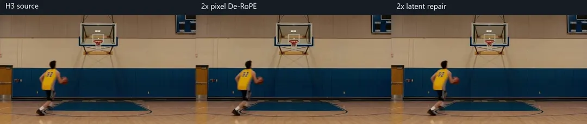
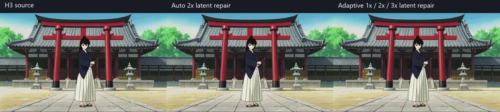

# H3 repair comparisons

Each panel shows the same output frame index at the original 24 fps. The 2× and 3× factors describe the expanded timeline used during refinement. The exported clips keep their original frame count. Click a preview to inspect a still. Download the MP4 for full-size playback or to hear the anime clip's audio.

## Backflip · Spatial and temporal repair

[Download MP4](backflip-spatial-temporal.mp4?raw=1) · [Inspect frame 10](backflip-spatial-temporal.jpg) · 39 frames

The source shows a doubled leg at frame 10. The joint latent pass refines the flip while increasing the native image size from 640 × 384 to 960 × 576. Both panels are displayed at the same size, with the source enlarged for presentation.

## Basketball · Pixel De-RoPE and latent repair

[Download MP4](basketball-pixel-vs-latent.mp4?raw=1) · [Inspect frame 12](basketball-pixel-vs-latent.jpg) · 39 frames

Both repair passes used 2× temporal expansion and the same Base schedule. Watch the ball, jersey, and takeoff. The latent route took about 86 seconds for this repair pass, compared with 123 seconds for the pixel route on the same machine.

## Anime slash · Auto 2× and adaptive repair

[Download MP4 with audio](anime-slash-adaptive.mp4?raw=1) · [Inspect frame 45](anime-slash-adaptive.jpg) · 90 frames

The right panel uses 3× on the fastest block and 2× on the following block. Watch how the redraw changes the sword arc and settles back into the following pose. The two repair passes can redraw poses differently even at the same output timestamps.
