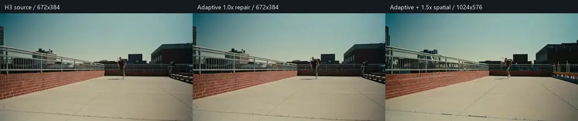
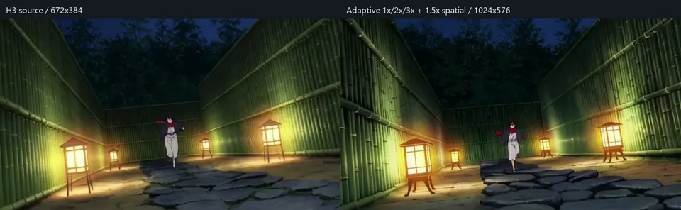
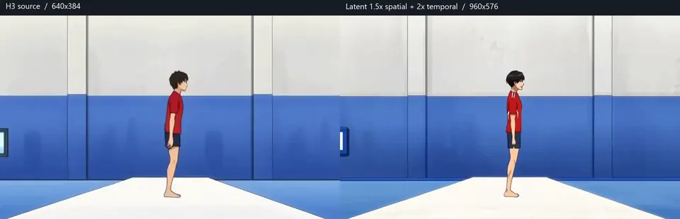

# H3 repair comparisons

Each panel shows the same output frame index at the original 24 fps. The 2× and 3× factors describe the expanded timeline used during refinement. The exported clips keep their original frame count and untouched Pass-1 stereo audio. Click a preview to inspect a still, or download the MP4 for full-size playback with audio.

## Live-action parkour · Adaptive 1.0× repair & decoupled 1.5× spatial *(v2.1 default)*

[Download MP4 with audio](parkour-live-v21.mp4?raw=1) · [Inspect frame 82](parkour-live-v21.jpg) · 90 frames (`3.75s`)

Generated with the v2.1 unified workflow defaults (`res_multistep`, `beta 16 / 0.35`, `BlockSparseAttention` `min_tokens=20480` / `end_percent=0.95` / `exact_kv_and_rows`, decoupled `spatial_checkpoint=auto`). Watch the landing face, hands, sneakers, and brick/railing lines: `1.0×` stays 100% dense and removes motion smear at `672×384`, while `1.5×` upgrades to crisp `1024×576` with zero grid artifacts.

## 2D anime courtyard slash · Adaptive 1×/2×/3× + decoupled 1.5× spatial *(v2.1 default)*

[Download MP4 with audio](anime-courtyard-v21.mp4?raw=1) · [Inspect frame 53](anime-courtyard-v21.jpg) · 90 frames (`3.75s`)

Adaptive motion detection expanded only the midair somersault and slash blocks (`[1, 1, 2, 3, 2, 1]`). Watch frame 53 and the spinning flip: the source smears and loses her face during the draw, while the v2.1 `1.5×` pass restores crisp cel linework, eyes, hands, and katana detail while keeping calm intro/landing frames faithful to Pass 1.

## Backflip · Spatial and temporal repair

[Download MP4](backflip-spatial-temporal.mp4?raw=1) · [Inspect frame 10](backflip-spatial-temporal.jpg) · 39 frames

The source shows a doubled leg at frame 10. The joint latent pass refines the flip while increasing the native image size from 640 × 384 to 960 × 576. Both panels are displayed at the same size, with the source enlarged for presentation.

## Basketball · Pixel De-RoPE and latent repair

[Download MP4](basketball-pixel-vs-latent.mp4?raw=1) · [Inspect frame 12](basketball-pixel-vs-latent.jpg) · 39 frames

Both repair passes used 2× temporal expansion and the same Base schedule. Watch the ball, jersey, and takeoff. The latent route took about 86 seconds for this repair pass, compared with 123 seconds for the pixel route on the same machine.

## Anime slash · Auto 2× and adaptive repair

[Download MP4 with audio](anime-slash-adaptive.mp4?raw=1) · [Inspect frame 45](anime-slash-adaptive.jpg) · 90 frames

The right panel uses 3× on the fastest block and 2× on the following block. Watch how the redraw changes the sword arc and settles back into the following pose. The two repair passes can redraw poses differently even at the same output timestamps.
