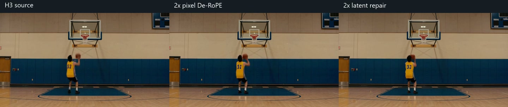
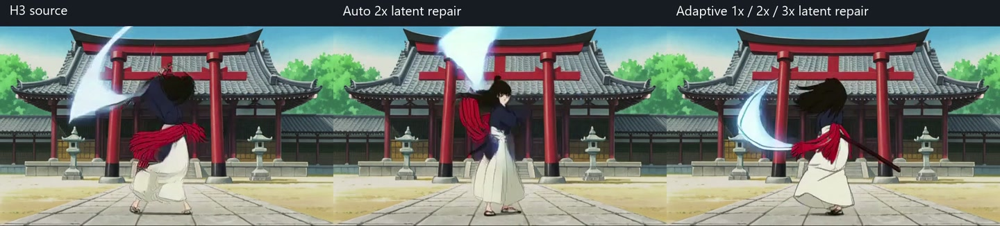

# H3 repair comparisons

Each panel shows the same output frame index at the original 24 fps. The 2× and 3× factors describe the expanded timeline used during refinement. The exported clips keep their original frame count.

## Backflip · Spatial and temporal repair

[Watch the MP4](backflip-spatial-temporal.mp4) · 39 frames

The source shows a doubled leg at frame 10. The joint latent pass refines the flip while increasing the native image size from 640 × 384 to 960 × 576. Both panels are displayed at the same size, with the source enlarged for presentation.

## Basketball · Pixel De-RoPE and latent repair

[Watch the MP4](basketball-pixel-vs-latent.mp4) · 39 frames

Both repair passes used 2× temporal expansion and the same Base schedule. Watch the ball, jersey, and takeoff. The latent route took about 86 seconds for this repair pass, compared with 123 seconds for the pixel route on the same machine.

## Anime slash · Auto 2× and adaptive repair

[Watch the MP4](anime-slash-adaptive.mp4) · 90 frames, with first-pass audio

The right panel uses 3× on the fastest block and 2× on the following block. Watch how the redraw changes the sword arc and settles back into the following pose. The two repair passes can redraw poses differently even at the same output timestamps.
